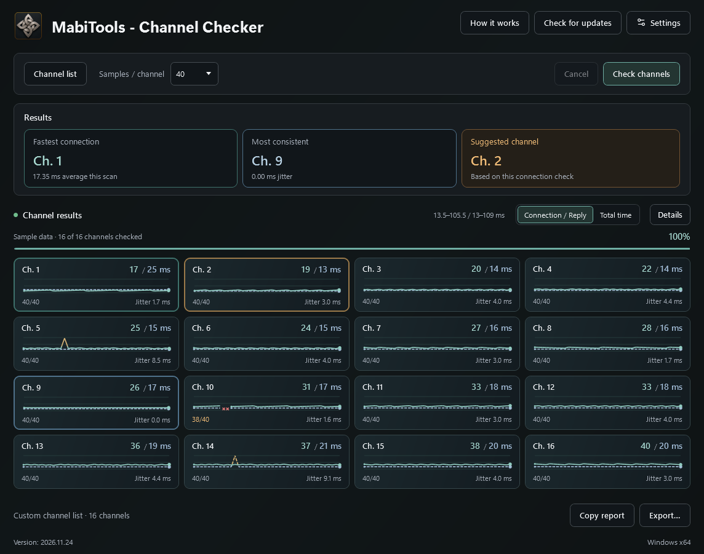

# MabiTools Channel Checker

Compare Mabinogi NA Erinn channels from your own PC. Run **Check channels** and
use **Suggested channel** for a practical choice based on that connection check.

Created and maintained by Nydri.

## Download

[Download Channel Checker for Windows x64](https://github.com/LOOKaUSERNAME/mabi-tools-releases/releases/tag/cc-v2026.11.26)
from the shared MabiTools release hub:
[Setup](https://github.com/LOOKaUSERNAME/mabi-tools-releases/releases/download/cc-v2026.11.26/MabiTools-Channel-Checker-2026.11.26-Setup-x64.exe)
or [portable ZIP](https://github.com/LOOKaUSERNAME/mabi-tools-releases/releases/download/cc-v2026.11.26/MabiTools-Channel-Checker-2026.11.26-win-x64.zip).

Windows 10 (build 19041) or later, x64, is required. Setup installs the Microsoft
Visual C++ Redistributable (x64) when it is missing or too old, and may ask for
administrator approval for that step. The portable ZIP requires version
14.50.35719 or later to be installed already.

## Quick start

1. Run Setup and open **Channel Checker** from Start, or extract the
   entire ZIP and open `MabiTools.ChannelChecker.exe`.
2. Pause large downloads, review **Channel list**, choose the number of samples
   per channel, and select **Check channels**. No scan starts automatically.
3. When the scan finishes, use **Suggested channel**. **Several channels look
   similar** means the choice is close; **Not enough data** means there is no
   qualified comparison. Change channels yourself in Mabinogi.
4. Use **Details** to inspect the results, or **Copy report** / **Export…** to
   keep the selected scan. You can cancel a scan at any time.

## Limits and privacy

This measures a connection from your PC, not in-game ping or battle performance.
It cannot establish server simulation time, skill delays or party-wide channel
health. Other players may get different results. Failed checks are not packet
loss and do not prove that a channel is offline.

**Connection time** measures how long TCP takes to connect. **Reply wait** is
the additional wait for the channel's opening message; **Total time** combines
the two. The suggestion considers successful checks, total time and jitter,
with enough observations across both halves of the scan to make a comparison.

Completed scans are saved locally by default and are **not uploaded**. Cancelled
scans are not automatically saved. **Settings** controls history saving, age and
storage limits, and **Clear saved history** asks before deleting saved scans.
Settings and history stay under `%LOCALAPPDATA%\MabiTools-ChannelChecker` and
survive uninstallation. Exported reports are kept separately.

Scans connect to the bundled channel addresses. Optional maintenance lookups
read public Mabinogi announcements through Steam while idle and stop before a
scan. The checker does not log in, switch channels, inspect game memory or send
gameplay commands.

## Updates

The app checks once when opened. Setup installations download a
newer release while idle and show **Update ready** after verifying it. Select
that button to review and confirm installation; Setup never starts silently.
Portable copies offer the matching portable ZIP instead. **Check for updates**
also provides a download link if a check fails. Background update work stops
before measured channel checks and resumes when they finish.

Native builds use a separate release feed from older C# builds.
See [update policy and packaging](docs/UPDATES.md) for verification details.

## More detail

- **How it works** in the app explains the results, charts and history controls.
- [Measurements and suggestions](docs/MEASUREMENTS.md) describes timing,
  eligibility, ranking and ties.
- [Legacy history import](docs/LEGACY_IMPORT.md) explains the optional, explicit
  import of verified WPF snapshots into a separate, read-only archive. Normal
  startup does not import older data.
- [Building](BUILDING.md) covers Windows builds, packaging and data locations;
  [architecture](docs/ARCHITECTURE.md) explains the C++ implementation.

The project uses the [MIT licence](LICENSE). Artwork and dependency notices are
in `licenses/`; binary packages include third-party licence notices and
corresponding source materials.

This community utility is not affiliated with or endorsed by Nexon.
